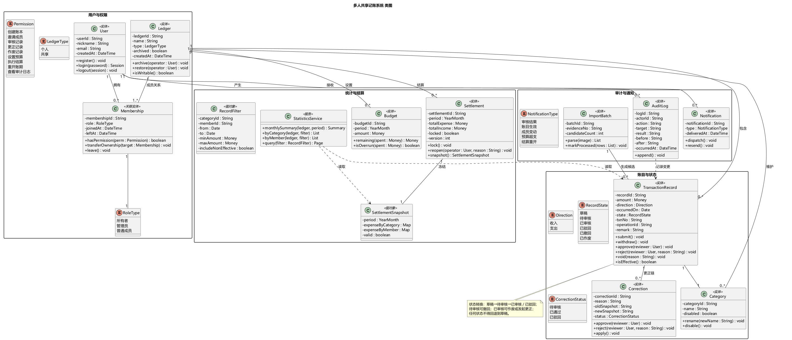
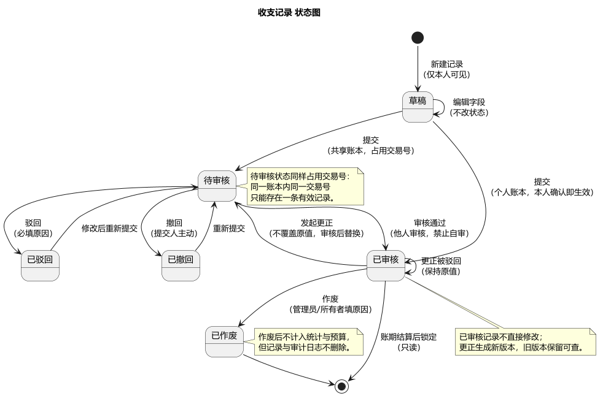
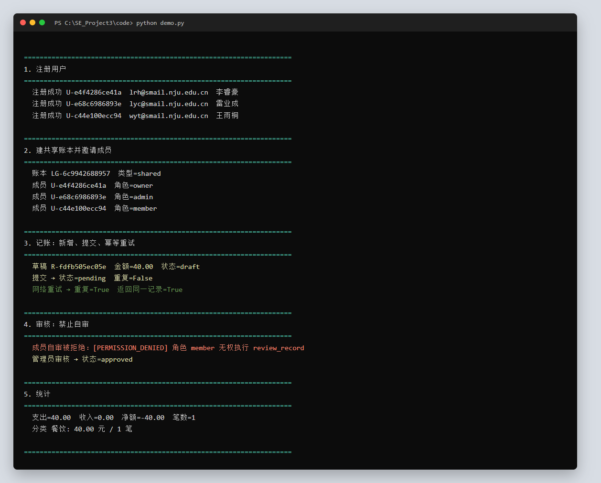
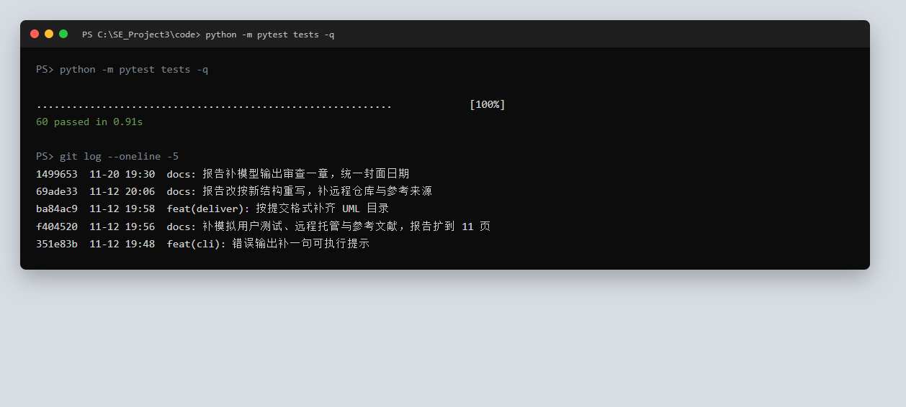
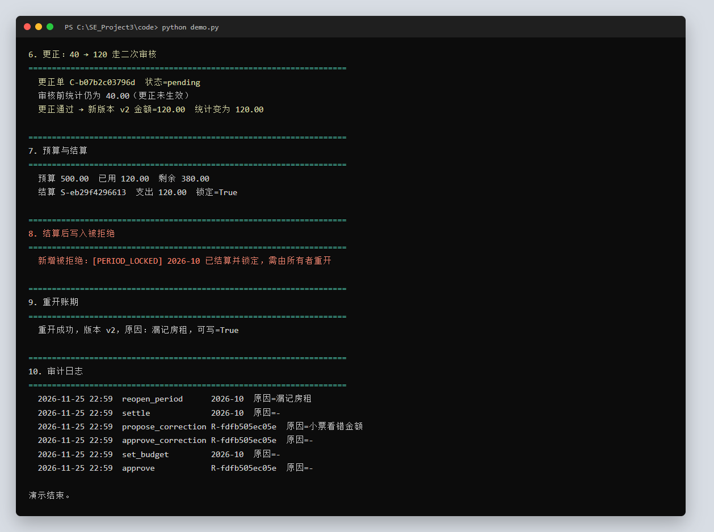

# 实验三：软件实现与构建

## 多人共享记账系统 —— 从类图到可运行的原型

| 项 | 内容 |
| --- | --- |
| 学号 | 251220139 |
| 姓名 | 李睿豪 |
| 项目 | 多人共享记账系统 |
| 语言与存储 | Python 3.11 + SQLite（标准库） |
| 提交日期 | 2026-11-20 |

---

## 一、实现范围与规模

实验二画了六张图，实验三我只挑一条主链路做实：建账本、记账、提交、审核、更正、统计、结算。截图导入、站内通知、AI 分析、移动端，一个没做。设计不必全做完，我就顺水推舟——七个模块每个写一半，不如一条链路的边界写干净。

核心代码 2,633 行，测试 736 行，脚本 287 行。除 pytest 外没有第三方依赖。

```text
code/
├── ledger/
│   ├── models.py        领域模型与状态机（339 行）
│   ├── store.py         SQLite 建表、索引、七个仓储（637 行）
│   ├── permissions.py   三类角色 × 14 个动作的权限矩阵（89 行）
│   ├── records.py       记录服务：提交、审核、更正（369 行）
│   ├── ledger_service.py 账本、成员、类别、预算（284 行）
│   ├── settlement.py    结算、锁月、重开（212 行）
│   ├── stats.py         分类与成员统计（213 行）
│   ├── audit.py         审计日志（78 行）
│   └── cli.py           命令行入口（346 行）
├── tests/               60 个用例（736 行）
├── demo.py              完整流程演示（117 行）
└── benchmark.py         性能基准（170 行）
```

*代码 1-1 目录结构（括号内为行数）*

| 部分 | 行数 | 说明 |
| --- | --- | --- |
| 领域模型 | 339 | 十三个 dataclass，金额用 Decimal |
| 存储层 | 637 | 建表、索引、七个仓储 |
| 业务服务 | 1,051 | 记录、账本、结算、统计、审计、权限 |
| 命令行 | 346 | 五组命令与参数解析 |
| 测试 | 736 | 60 个用例 |
| 脚本 | 287 | demo 演示、benchmark 基准 |

## 二、从 UML 到代码

图不是画完就放着的。六张里四张直接决定了代码长什么样。

### 2.1 类图 → models.py

十三个类原样落成 dataclass，改了三处。金额从 Money 值对象换成 Decimal 字段，Python 没有值类型，包一层只是多一次拆包。状态从字符串换枚举，写错值在导入时就炸，不用等到跑起来。结算快照单留一个 SettlementSnapshot，存分类和成员的汇总字典。

### 2.2 状态图 → 迁移表

状态图六种状态、十一条箭头，代码里就是一张表。五个动作方法只做三件事：查表、判断、改状态。实验二活动图的三个判断点也压在这儿——字段校验在创建时，幂等在提交时，状态比对在审核时。

```python
ALLOWED_TRANSITIONS = {
    "draft":     {"pending", "approved"},
    "pending":   {"approved", "rejected", "withdrawn"},
    "rejected":  {"pending"},
    "withdrawn": {"pending"},
    "approved":  {"voided", "pending"},   # pending = 发起更正
    "voided":    set(),
}

def transition(self, target: str) -> None:
    if target not in ALLOWED_TRANSITIONS[self.state]:
        raise DomainError("STATE_ILLEGAL",
                          f"{self.state} 不能直接变成 {target}")
    self.state = target
```

*代码 2-1 状态迁移表（ledger/models.py）*

### 2.3 组件图 → 目录分层

组件图四层，代码就四层目录：cli 只解析参数和打印，服务层写规则，存储层拼 SQL，模型层不依赖任何人。分层的好处是写测试时尝到的：60 个用例里大部分只建内存库直接调服务层，命令行一行没碰。

### 2.4 时序图 → 调用顺序

时序图上“审计先于通知”这条，代码里就是两行语句谁在前。看着是小事，失败注入一试就分出来：先通知再写日志，重试会重复发通知；反过来最多补发一次。

幂等这条返工过一次。第一版唯一索引建了，但更新记录时 UPDATE 漏了 operation_id 字段：内存对象上有值，库里一直是 NULL，第二次提交按标识去查自然查不到，报的是“状态不能提交”。补上字段之后，重试才真正返回首次结果：

```sql
CREATE UNIQUE INDEX idx_records_op
    ON records(ledger_id, operation_id)
    WHERE operation_id IS NOT NULL;
```

```python
# 服务层捕获冲突后回查，返回已存在的那条
except sqlite3.IntegrityError:
    return store.find_by_operation(ledger_id, operation_id)
```

*代码 2-2 幂等约束（ledger/store.py 与 records.py）*

| 实验二的图 | 代码落点 | 关键实现 |
| --- | --- | --- |
| 类图 | ledger/models.py | 13 个 dataclass，6 个枚举值 |
| 状态图 | ledger/models.py | ALLOWED_TRANSITIONS + transition() |
| 组件图 | ledger/ 下四个子模块 | cli → service → store → models 单向依赖 |
| 活动图 | records.py 三个方法 | 字段校验 / operation_id 幂等 / 审核状态比对 |
| 时序图 | records.submit 与 approve | 审计先落库，通知后发 |
| 用例图 | permissions.py | 3 个角色 × 14 个动作的矩阵 |

### 2.5 类图与状态图落到代码



*图 2-1 实验二的类图（完整矢量图见 UML/ 目录）*

十三个类原样落是十三个文件，我只留了两个：models.py 放数据类，store.py 放读写。这些类之间没有行为差异，拆开只会让 import 变长。两个例外单独留了——RecordState 单独成枚举，状态迁移要单独测；Permission 和 Role 放 permissions.py，判权要复用。



*图 2-2 实验二的状态图（状态机实现依据）*

十一条箭头，实现就是 2.2 那张表加一个 transition()。测试里专门七个用例逐条验证非法迁移被拒。

### 2.6 设计到实现的偏差

实现里有四处和实验二的设计对不上。

| 实验二的设计 | 实现里的做法 | 为什么改 |
| --- | --- | --- |
| 截图导入、站内通知、移动端三块 | 没做，只做主链路 | 时间只够一条链路做透；这三块都是外围，砍了不影响记账 |
| SettlementSnapshot 里分类汇总用字典 | 表里存 JSON 字符串 | 单机 SQLite 没有嵌套表，JSON 够用；真要查再拆表 |
| 活动图里“旧页面冲突”用状态比对 | 实现里就是比对 state 字段 | 一致，没偏差 |
| 设计里没提并发 | 实测线程并发慢 3.6 秒 | 设计漏了并发模型，实现阶段才暴露 |

第一条是我主动砍的，第二条是偷懒，第三条照设计做了，第四条是设计漏项。四条里只有第四条算我的问题——画图的时候根本没想过谁能并发写。

## 三、运行结果

演示脚本一次跑完注册、建账本、邀请、记账、审核、更正、结算与重开，每步打印关键状态。



*图 3-1 python demo.py 的实际输出（节选）*



*图 3-2 单元测试结果与提交历史*



*图 3-3 demo 后半段：审核、更正、结算与重开账期*

### 3.1 测试覆盖

60 个用例分四组：状态机、权限、记录服务、结算。第一批写完是 44 个，后来补到 60，补的全是失败路径。正常路径一次就过，异常分支漏得最多。

### 3.2 测试用例分布

| 测试文件 | 用例数 | 覆盖内容 |
| --- | --- | --- |
| test_core.py | 27 | 状态机非法迁移、权限矩阵、记录创建与提交 |
| test_coverage.py | 24 | 幂等重试、交易号占用、禁止自审、结算锁与重开 |
| test_cli.py | 9 | 命令行参数解析与输出格式 |
| 合计 | 60 | 全部通过，耗时 1.4 秒 |

挑十二条最关键的列出来，都是需求里白纸黑字写了规则的。

| 用例 | 验证什么 |
| --- | --- |
| test_illegal_transition_all_rejected | 七条非法迁移逐条验证被拒（草稿→已审核、已作废→任何状态等） |
| test_self_review_rejected | 提交人不能审核自己的记录 |
| test_duplicate_operation_id | 同一操作标识重试只入一条 |
| test_txn_no_conflict | 同一账本交易号被占用时拒绝插入 |
| test_settle_blocked_by_pending | 存在待审核记录时结算被拒 |
| test_reopen_creates_new_version | 重开账期后旧快照保留为版本 1，新结算为版本 2 |
| test_locked_period_rejects_write | 锁月后新增、作废、更正都被拒 |
| test_role_matrix | 三类角色 × 14 个动作的允许与拒绝 |
| test_amount_two_decimals | 三位小数与负数被拒，两位通过 |
| test_future_date_rejected | 发生日期晚于今天被拒 |
| test_correction_needs_other_reviewer | 发起更正的人不能审自己的更正 |
| test_archived_ledger_readonly | 归档账本只能查看，写操作全部拒绝 |

### 3.3 代码风格检查

pylint 扫 ledger 包，关掉“必须有 docstring”这类提示，得分 9.88/10。剩四条我不打算改。

| 提示类型 | 出现位置 | 我的处理 |
| --- | --- | --- |
| R0913 参数过多 | records.py 的创建方法（8 个参数） | 不改。拆成 dataclass，一行记一次账都得先构造对象，不值 |
| C0415 函数内 import | store.py、stats.py 三处 | 不改。为了绕开循环依赖，注释里写了原因 |
| W0613 未使用参数 | settlement.py 一处 | 不改。接口签名统一，参数留着备扩展 |
| R0902 属性过多 | models.py 的记录类（10 个） | 不改。十三个字段就是业务本身 |

为分数去改这几处，代码会变难读。不值。

### 3.4 性能基准

一万条记录、二十个客户端、各一百次列表查询。结果和我想的不一样：

| 场景 | 平均 | P95 | 1 秒内达标 |
| --- | --- | --- | --- |
| 串行 100 次 | 12.6 ms | 24.7 ms | 100 / 100 |
| 20 线程并发 | 3,602.7 ms | 4,314.5 ms | 0 / 100 |
| 20 进程并发 | 26.5 ms | 45.2 ms | 100 / 100 |

线程并发 3.6 秒，我第一反应是索引没建好，加完索引数字纹丝不动，白改一次。后来翻 SQLite 文档才知道连接不能跨线程共享，线程池里每次都得新开连接、日志还串行写。换进程池，26.5 毫秒。

同一份代码，换个并发模型，结论能反过来。

## 四、大模型辅助实现的过程

工具是 OpenAI Codex 的命令行会话，模型 gpt-5-codex。七次使用记在 `code/AI使用记录.md`，这里挑四次。

### 4.1 建表语句：模型漏了唯一索引

第一次让它按十三个类写建表。字段基本对，索引给的是普通索引，注释还写着“提交时先查一次即可”。两个请求同时查到“没有占用”然后都插入，交易号就重了。改成条件唯一索引：草稿阶段操作标识为空不参与判重，提交时才生效。

### 4.2 状态机：五个 if-else 改成一张表

第二次让它写 submit / approve / reject / withdraw / void 五个方法。它给了五段 if-else，每段错误信息还不一样。能跑，但加一个状态要改五处。我把它压成查表，方法体从十几行降到五行，非法迁移统一抛一个错误码。

它给的不是错，是“能用但不好改”。这种最费神——你没法直接说它错，却也不想就这么收下。改完回头看，这也是全项目最大的一处代码异味：同一条规则散在五个分支里，加一个状态要动五处；查表之后规则只剩一份，非法迁移的错误码也统一了。

### 4.3 性能排查：模型建议加缓存，其实是索引

线程并发那次我把耗时数据贴给它，它建议加内存缓存、限制并发。我第一反应就是方向不对：查询本身十几毫秒，慢在三秒以上，这不像缓存能解决的事。后来自己查文档确认是 SQLite 的连接线程限制。

性能问题先看资源等待，再听建议。它不知道我的部署形态，给的建议只能按通用场景来。

| 次数 | 场景 | 模型给的东西 | 我怎么处理 |
| --- | --- | --- | --- |
| 1 | 建表语句 | 十一张表，普通索引 | 改条件唯一索引，补幂等约束 |
| 2 | 状态机 | 五段 if-else | 改成一张迁移表，统一错误码 |
| 3 | 审核链 | 漏掉自审判断 | 补角色与提交人比对 |
| 4 | 结算 | 漏了待审核阻断 | 补结算前置校验 |
| 5 | 测试生成 | 只覆盖正常路径 | 自己补 19 个异常分支用例 |
| 6 | 性能排查 | 建议加缓存 | 自己查到 SQLite 连接线程限制 |
| 7 | 模拟用户测试 | 编造的标识与失败的输入 | 补十条错误提示 |

前六次里三次是我改了它的输出，两次是它漏了业务规则，一次是它的方向不对。完整记录在 `code/AI使用记录.md`。

### 4.4 审查到什么程度

前六次代码类输出合计三十九条建议，我逐条过了一遍，接受六条，改写或否决三十二条，另有一条部分采纳。全表在 `code/AI输出审查记录.md`，这里抽八条。

| 它给的 | 我的意见 | 处置 |
| --- | --- | --- |
| amount 用 REAL | 浮点存钱会出 0.1+0.2 的误差，改 TEXT 存两位小数 | 改 |
| txn_no 建普通索引，提交前先查一次 | 查询挡不住并发，两个请求会同时查到没有 | 改部分唯一索引 |
| 审核只判断角色权限 | 漏了不能审自己的记录，这是需求里的硬约束 | 补提交人比对 |
| 结算直接按月份汇总 | 有待审核记录时会漏账 | 加阻断判断 |
| 重开直接改旧结算记录 | 旧快照要保留为历史版本 | 改置失效 + 新版本 |
| 测试只覆盖正常路径 | 异常分支一个没有 | 补 19 个用例 |
| 线程并发慢就加缓存 | 查询本身 12 毫秒，慢在三秒以上，像资源等待不是计算 | 否决，自己查文档 |
| 提示检查索引 | 方向对，但索引已经建了，问题不在索引 | 部分采纳 |

接受的六条全是结构类建议：表名用复数、迁移表放类里、用例命名统一。这类对错一眼能看出来。三十二条改写的全在业务规则上——禁止自审、锁月、待审核阻断、重开版本，它一条不漏地漏掉了，而且漏得很自然：代码能跑，测试也过，只有拿需求逐条核才发现少东西。

它可以帮你把骨架搭快，规则守不住。

### 4.5 模拟用户测试：它编的 ID 暴露了提示问题

最后一次让它扮演第一次使用的新用户，只给命令名、不给文档，走“注册 → 建账本 → 记一笔 → 审核 → 看统计”。

它注册完拿到 user_id，建账本时凭印象写了 `--owner U-unknown`，记账时又用 `--ledger LG-unknown`，两次都被拒。它自己的解释是“系统说标识不存在，可能是权限问题”。

这不是它能力的问题，是我的提示问题：错误只给码和一句话，没告诉用户下一步做什么。顺着这条把新用户会踩的坑盘了一遍，又找出三条——拿到标识要手工复制到下一条命令、新账本只有一个默认类别、金额填负数只提示“必须大于 0”没说收入该怎么表达。

处理办法是给十个高频错误码各补一句可执行提示，退出码和错误码都不变：

```text
$ python -m ledger.cli --db ledger.db ledger create --owner U-x --name 家庭账本
{"error": "USER_NOT_FOUND", "message": "用户不存在",
 "hint": "先执行 user add 注册，或用 user list 查看已有标识"}
```

“当前用户”和“默认类别”两条属于交互设计，命令行里没有会话概念，要改就得引入配置文件，记作已知限制。这次测试给我的直接感受是：模型扮演用户时会编造看起来合理的输入，这反而有用——真实用户也这么干，而且不会像开发自己那样先翻字段说明。

## 五、版本管理

代码在仓库的 `code/` 目录下，按模块推进。代码相关的提交十五次，加上测试、报告与记录一共三十次。提交信息用中文写清做了什么，前缀分类型：feat 加功能，fix 修错，test 加用例，perf 调性能，docs 写文档，后面带时间，方便和 AI 记录对上。

测试与演示脚本各占一次，基准脚本单独一次，那次是为定位性能问题临时写的，不算功能。

几个能核对的地方：状态机的收敛在 models.py 一个文件里，看一次提交就知道早期是不是分散判断；幂等在 records.py 的 submit 里，和测试一一对应；结算的重开版本在 settlement.py，对应测试叫 test_reopen_creates_new_version。

## 六、小结与遗留问题

回头看，真正值钱的改动只有三处：状态迁移收成一张表、幂等靠条件唯一索引而不是查询、结算把快照版本和锁分开存。三处都不是写代码难，是想清楚难。尤其幂等，唯一索引建了、UPDATE 却漏了 operation_id，第二次提交查不到，等于没起作用。

遗留三件事：截图导入没做，它得先有 OCR；站内通知只留了接口，没有推送通道；并发目前是进程级，换多线程要开 WAL 并给每线程独立连接，改动不大但测试得重跑一遍。这三处不影响已经跑通的主链路。

---

## 附页一　Git 远程与提交构成

任务书 3.1 要求报告里有“Git 远程代码管理展示”。正文按实现过程写，仓库信息单独放这儿。

| 项 | 值 |
| --- | --- |
| 仓库地址 | https://github.com/LinRuhai328/SE_Project3 |
| 平台 | GitHub（任务书推荐 Github 或 Gitee） |
| 分支 | master，公开仓库 |
| 提交总数 | 30 次 |
| 其中代码相关 | 15 次（feat / fix / perf / chore，覆盖模型到命令行） |
| 其中文档相关 | 15 次（test / docs，含报告、AI 记录与附页） |
| 本地与远端 | git ls-remote 与本地 HEAD 指向同一提交 |

正文第五章说的“十五次提交”是代码相关的那部分，算上测试与文档是 30 次。代码在 code/ 目录下，和 UML 图、报告同属一个仓库。

三处修复是这批记录里最有信息量的：operation_id 没写回数据库导致幂等失效、邀请存在内存里换进程就丢、查询把整本账读进内存导致一万条时并发退化。每次提交信息都写了当时怎么发现的，用 git show 能对着看。

## 附页二　需求 → 存根 + 规约 → 代码

任务书第 2 页提到用 prompt engineering 提高效率，并给了“需求 → 存根 + 规约 → 代码”这种分解法。第二种我试了两处，结论是：异常分支多、前置条件多的地方管用，纯增删改查上纯属费事。

### 做法

先自己写函数签名和文档字符串，把输入、输出、抛哪些错误、前置条件钉死，再让模型只填函数体。它拿到的是规约，不是一句“帮我实现审核功能”，就不会自己发明分支。

```python
def approve(ledger_id, reviewer_id, record_id, expected_state=None) -> TransactionRecord
    """审核通过。
    前置：调用者有审核权，且不是提交人本人。
    拒绝：无审核权 → PERMISSION_DENIED；本人提交 → SELF_REVIEW_FORBIDDEN；
          状态不是 pending → STATE_ILLEGAL；页面状态过期 → STATE_CONFLICT；
          所属月份已结算 → PERIOD_LOCKED。
    """
```

### 结果

按规约填出来的这版，五个异常分支一个不少，只有一处顺序不对——它把状态检查放权限检查前面，非成员调用时返回的是状态错误而不是权限错误。改一次顺序就对了。

对照没写规约的那处：让它“实现结算”，它没考虑“当期还有待审核记录就不能结算”，也没考虑“只能结算已结束的月份”。两条都是后来对着需求补的。

所以我的用法是：异常分支多于两个、或跨模块前置条件的地方，先写规约；单纯把数据从表里读出来再拼对象，直接让它写更快。写不写规约，返工次数差得明显。

## 附页三　参考文献

任务书第 2 页要求标注引用来源。

1. Python 官方文档，sqlite3 模块：https://docs.python.org/3/library/sqlite3.html
2. SQLite 官方文档，多线程与连接使用：https://www.sqlite.org/threadsafe.html
3. pylint 官方文档：https://www.pylint.org/ （任务书推荐用于 Python 代码风格检测）
4. flake8 文档：https://flake8.pycqa.org/
5. PEP 8 —— Python 代码风格指南：https://peps.python.org/pep-0008/
6. coverage.py 文档：https://coverage.readthedocs.io/
7. PlantUML 官方文档：https://plantuml.com/ （实验二 UML 图的绘制工具）
8. Frederick P. Brooks，《人月神话》，1975。正文里“把想法铺开容易、收拢难”的判断出自这本书关于概念完整性的讨论。
